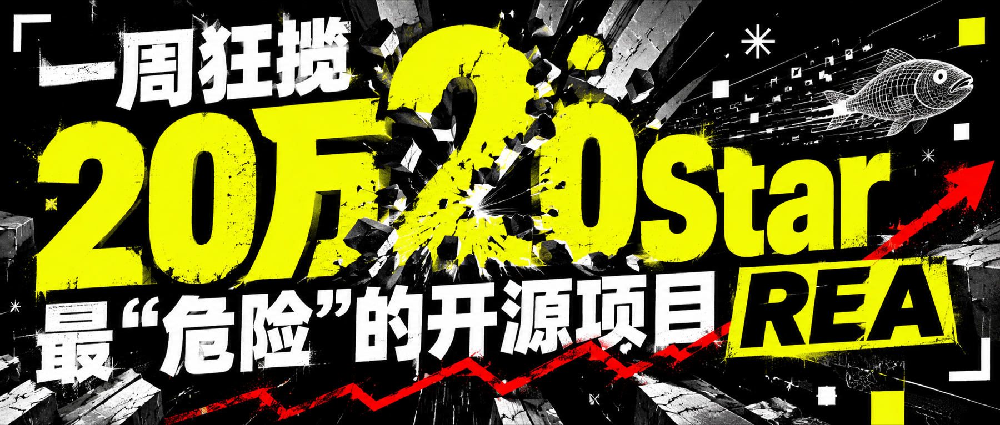
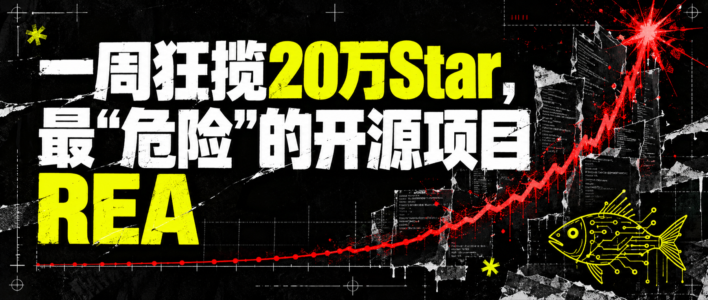
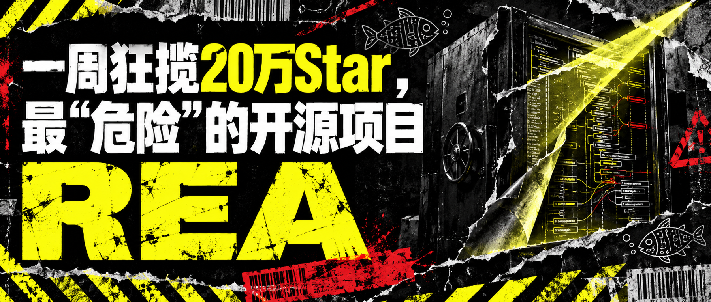

# GZH Cover Image Generator

`gzh-cover-image-generator` 用于生成高冲击力、标题内嵌的微信公众号横版封面。它的目标不是把文章缩成一张信息图，而是让读者在信息流里停下来，并在一眼之内读到标题和核心冲突。

## 参考效果



**数字冲击：** 用超大数字、爆裂结构和标题层级制造第一眼传播力，适合数量级变化、热点事件和强情绪选题。

<table>
<tr>
<td width="50%" valign="top"><br><strong>增长曲线</strong><br><sub>适合爆发、增长与旧秩序被击穿。</sub></td>
<td width="50%" valign="top"><br><strong>档案调查</strong><br><sub>适合危险、调查、警示与规则边界。</sub></td>
</tr>
</table>

参考图只用于校准视觉语言。每次生成仍要围绕当前文章重新选择隐喻，不应照抄标题或构图。

## 默认视觉语言

- `1800 x 766`，严格使用 `2.35:1` 横版比例。
- 黑底、脏白和荧光黄形成高对比，允许少量安全红。
- 巨型中文标题、极端字号对比、轮廓英文和实验性排版。
- 工业印刷、地下刊物、后现代解构和数字朋克气质。
- 几何框架、星号、线条鱼、重复文本和数字化标记形成视觉节奏。
- 标题必须逐字保留，包括数字、中英文、引号和标点。

默认生成 3 个创意方向。每个方向只改变一个核心隐喻，方便比较，而不是堆叠更多元素。

## 安装

```bash
npx skills add chokcoco/coco-skill-hub --skill gzh-cover-image-generator
```

## 使用示例

```text
使用 $gzh-cover-image-generator，为下面这篇文章生成 3 张公众号封面：

标题：一周狂揽20万Star，最“危险”的开源项目 REA
核心冲突：开源工具正在降低软件逆向和重建的门槛。

标题必须逐字嵌入图片，输出 1800 x 766 PNG，
三个候选分别围绕增长曲线、危险档案和数字冲击展开。
```

## 模型与检查

首选 **GPT Image 2.5**，不可用时使用 **GPT Image 2**。生成后必须人工核对中文标题，重点检查错字、标点、裁切和缩略图可读性。标题不正确时，应只针对文字问题重试。

这个 Skill 不用于正文技术插图、产品 UI、Logo 或精确数据图表。需要解释技术结构时，应改用 `technical-image-generation`。

## 目录说明

- `SKILL.md`：尺寸、文案、视觉语言和生成工作流。
- `references/cover-style.md`：完整视觉规范、参考资产说明和 Prompt 要点。
- `assets/reference-covers/`：三张用于风格校准的参考封面。

