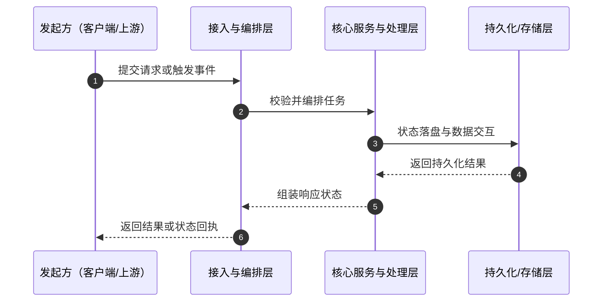

<!--
作者规划模板，不可直接渲染为学生正文。
先在 COURSE-BLUEPRINT.md 登记本章采用的模块、采用条件、不采用理由和完成证据；删除未采用模块，再用经核验的课程内容替换本模板。所有占位符均保留在 HTML 注释中，不能进入学生可见产物。
-->

# <!-- 章节/文章标题：核心主题与高维视角 -->

<!-- 以下模块按需选择，不构成固定章节目录。 -->

## 模块：开场（仅在问题情境有助于理解时采用）

<!--
使用真实、可核验的工程痛点、典型误区或直觉方案的限制，说明本章要解决的问题；
零基础概览或这类情境会造成前置断层时，改为学习对象、必要背景和完成目标。
-->

> **【开场抽象与全局观】**
>
> <!-- 段落 1：工程痛点与常见误区 -->
> <!-- 段落 2：本质抽象与高维视角 -->
> <!-- 段落 3：本章知识主线与学习目标 -->

---

## 模块：知识逻辑图谱（仅在关系难以用短段落说明时采用）

<!-- 说明知识点之间的逻辑递进关系；关系简单时使用必要的过渡句，不强制作图。 -->

---

## 模块：核心概念与术语铺垫（仅在当前学习成果需要时采用）

### 核心术语剖析

<!--
总览章节可建立简明锚点，并在蓝图登记后续详细章节；
专门讲解该知识模块时，按需完整说明：定义、背景与痛点、版本/技术演进、核心机制、极简 Demo。
-->

> <!-- 术语名：定义，当前作用与边界 -->

### 术语/技术的基础用法示例（仅在示例能降低理解成本时采用）

<!-- 放入已经验证、只承载当前概念的最小代码或配置；在相邻文字说明可观察结果。 -->

---

## 模块：核心机制、拓扑与数据流转（仅在因果链或状态流转是完成证据时采用）

### 架构拓扑与链路流转

<!-- 使用流程图或时序图说明交互关系。 -->

### 核心状态/数据变迁矩阵（仅在字段对比有助于判断时采用）

| 状态/阶段 | 触发条件 | 核心行为/职责 | 允许的操作 | 严禁的行为 |
| :--- | :--- | :--- | :--- | :--- |
| <!-- 阶段一 --> | <!-- 条件 --> | <!-- 职责 --> | <!-- 操作 --> | <!-- 禁止项 --> |
| <!-- 阶段二 --> | <!-- 条件 --> | <!-- 职责 --> | <!-- 操作 --> | <!-- 禁止项 --> |
| <!-- 阶段三 --> | <!-- 条件 --> | <!-- 职责 --> | <!-- 操作 --> | <!-- 禁止项 --> |

---

## 模块：业界同类解法横向发散与技术选型（仅在学习者需要作选择时采用）

<!--
仅比较真实可选、并且会影响当前决策的方案；没有真实项目时，不写“本项目选择”。
三项以上且需要逐字段比较时使用表格；条件分支复杂时再使用决策树。
-->

### 主流解法横向对比

| 对比维度 / 方案 | <!-- 方案 A --> | <!-- 方案 B --> | <!-- 方案 C（如适用） --> |
| :--- | :--- | :--- | :--- |
| 架构复杂度 | <!-- 证据 --> | <!-- 证据 --> | <!-- 证据 --> |
| 性能与吞吐量 | <!-- 证据 --> | <!-- 证据 --> | <!-- 证据 --> |
| 可靠性与运维成本 | <!-- 证据 --> | <!-- 证据 --> | <!-- 证据 --> |
| 适用场景/边界 | <!-- 证据 --> | <!-- 证据 --> | <!-- 证据 --> |

### Trade-offs 与决策条件

<!--
说明当前案例选择某方案的约束，以及在何种条件下应选择其他方案。
所有性能、版本和产品行为断言都需有对应来源。
-->

---

## 模块：生产级代码实现与设计防线（仅在实现或验证是学习成果时采用）

### 实战代码与可观察结果

<!-- 放入已运行或测试的代码；说明关键边界处理、可观察输出及其含义。 -->

> **生产级防线与踩坑指南（如适用）**
>
> <!-- 常见隐患与对应防线，例如幂等校验、防腐层隔离、并发锁、超时降级 -->

---

## 模块：系统化收束与后续衔接（按需借用，适用于其他正文类型）

<!--
仅在本章已经建立足够证据、且收束能帮助迁移或复盘时采用。
选择系统化思维、选型哲学、演进观和后续衔接中的一项或多项；不把它们写成口号或固定三段式。
-->

### 系统化思维

<!-- 基于本章证据提炼可跨语言、跨框架复用的机制或架构规律。 -->

### 选型哲学

<!-- 总结当前约束下的取舍，并说明适用边界。 -->

### 演进观

<!-- 区分已实现事实、目标方向和教学简化；说明当前方案的边界与可能演进。 -->

### 后续衔接（仅在存在真实依赖时采用）

<!-- 说明下一章节将承接的已建立知识与待解决问题。 -->
